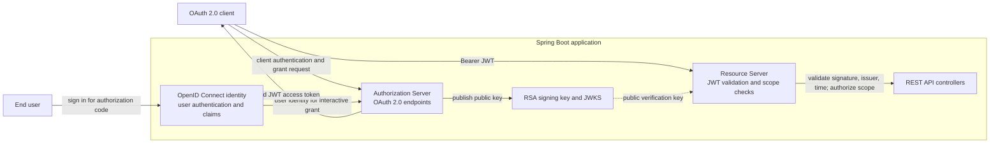
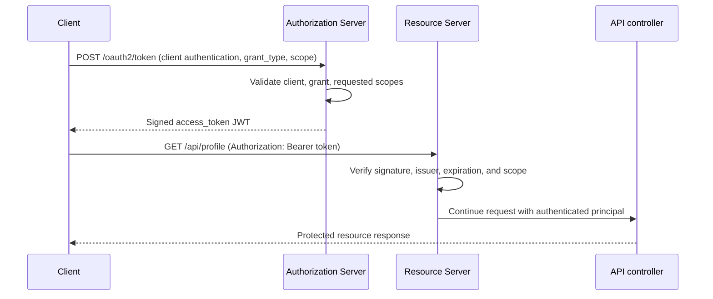

# Architecture and Request Flows

## Roles and boundaries

This sample hosts three protocol roles in a single Spring Boot process. They
share a port and runtime, but each role has a distinct responsibility:

| Role | Responsibility | Implementation |
| --- | --- | --- |
| Authorization Server | Authenticates OAuth clients, applies grant and scope policy, issues signed access tokens, and exposes protocol metadata | `config/AuthorizationServerConfiguration.java` and Spring Authorization Server |
| OpenID Connect Provider | Adds identity authentication and identity-related endpoints/claims to OAuth 2.0 | OpenID Connect enabled on the authorization server; demo user in `identity/IdentityConfiguration.java` |
| Resource Server | Accepts bearer access tokens, validates them, and applies scope-based authorization to APIs | `config/ResourceServerConfiguration.java` and `api/ApiController.java` |
| Client | Requests a token and presents it to a resource | `demo-client`, registered in memory by authorization-server configuration |

The identity configuration supplies a user for interactive login. It is not
the authorization server and it does not itself issue tokens. Likewise, the
resource server consumes access tokens; it does not authenticate a client to
the token endpoint.

## Component diagram



For this single-process demo, token signing and token verification use the
same configured key pair. A separately deployed resource server should obtain
the trusted issuer's public keys through its metadata/JWKS endpoint and must
not receive the private signing key.

## Client-credentials flow



The client-credentials grant authorizes the client itself. The JWT subject is
therefore the client identifier in this flow, not a logged-in user.

## Authorization-code and identity flow

```mermaid
sequenceDiagram
    participant B as User agent / client
    participant AS as Authorization Server
    participant ID as Identity login
    participant C as OAuth client
    B->>AS: Authorization request (response_type=code, scopes, PKCE challenge)
    AS->>ID: Require user authentication
    ID-->>B: Login form
    B->>ID: User credentials
    ID-->>AS: Authenticated user
    AS-->>B: Redirect with authorization code
    B->>C: Deliver code to registered redirect URI
    C->>AS: Exchange code with PKCE verifier
    AS-->>C: Access token and ID token (OIDC); refresh token when issued
```

The demo client is configured for PKCE and registers a localhost callback.
Production clients must use redirect URIs they control and protect their
credentials. OpenID Connect is requested using the `openid` scope; `profile`
requests profile information. Do not interpret a client-credentials token as
an end-user login.

## JWT and API authorization

1. The authorization server builds token claims and signs the JWT with its RSA
   private key. The access token is short-lived (15 minutes in this sample).
2. The JWK Set endpoint publishes the corresponding public key. Its key ID
   identifies the key that signed a JWT.
3. On a bearer-token request, Spring Security verifies the signature using the
   public key, checks standard time claims and the configured issuer, and
   creates an authenticated principal.
4. Spring Security converts token scopes into authorities named
   `SCOPE_<scope>`. The resource-server filter chain enforces:

   | Route | Policy |
   | --- | --- |
   | `/api/public` | No token required |
   | `/api/admin/**` | `SCOPE_api.write` |
   | Other `/api/**` | `SCOPE_api.read` |
   | Other requests | Authentication required unless handled by an earlier protocol filter chain |

A missing or invalid bearer token is normally rejected with HTTP 401. A valid
token without a required scope is rejected with HTTP 403. Authorization server
protocol endpoints are handled by the higher-priority filter chain before API
rules are evaluated.

## Configuration and source map

- `OAuthJwtApiApplication` is the Spring Boot entry point and component-scan
  root.
- `config/AuthorizationServerConfiguration` declares the client, RSA key,
  JWK source, issuer settings, JWT decoder, OIDC support, and the
  authorization-server filter chain.
- `identity/IdentityConfiguration` exposes the in-memory sample user for
  interactive login.
- `config/ResourceServerConfiguration` defines bearer authentication and
  route-level scope requirements.
- `api/ApiController` implements example public, read-scoped, and write-scoped
  resources.
- `application.properties` sets the port and configurable issuer URL.
- `OAuthJwtApiIntegrationTest` verifies token issuance, access decisions, and
  discovery/JWKS publication through HTTP.

## Trust and deployment notes

This is an educational, single-process configuration—not a production
identity platform. The sample client and user are in-memory, and a fresh RSA
key is generated on every startup. This makes the demo easy to run but means
client/user data is not durable and existing JWTs stop verifying after a
restart. Use persistent credential stores, a securely managed and rotated
signing key, HTTPS, and a stable issuer before deployment. Configure the
issuer to the exact externally visible issuer URL clients and resource servers
trust. Never distribute the RSA private key to a separately deployed resource
server.
